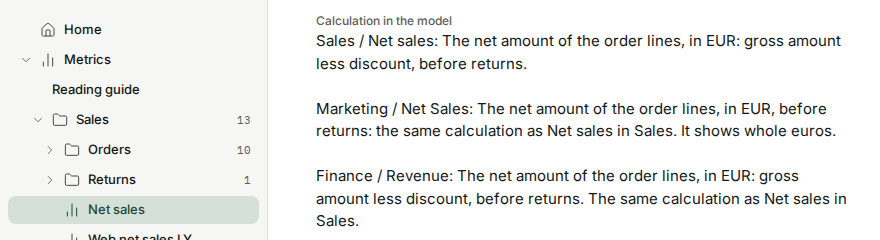

# Power BI Metrics Book

Power BI Metrics Book is a self-hosted catalog of your Power BI metrics and an MCP server for AI assistants. When someone asks Claude or Codex for a number, the assistant can look up how your team defines it, find the DAX measure that calculates it, and run the query with that person's Power BI permissions.

[Website](https://powerbimetricsbook.io/) · [Try the live demo](https://demo.powerbimetricsbook.io/) · [Read the docs](https://powerbimetricsbook.io/docs/) · [Self-host it](https://powerbimetricsbook.io/docs/start/quickstart/)

## One metric across three datasets

Does net sales include returns? In the sample tenant, the definition is gross order value less discounts, before returns, in EUR. The Sales dataset calls its measure `Net sales`. Finance calls the same calculation `Revenue`. Both appear under [Net sales in the live demo](https://demo.powerbimetricsbook.io/catalog/metrics/net_sales).



The catalog mirrors Power BI metadata. Agents can search metrics, columns and glossary terms, inspect a measure's DAX, and query Power BI through MCP, the `pbmb` CLI or the REST API. Power BI enforces the asking person's permissions on every query. The agent gets a short result preview and can read more rows by page or download the full CSV.

## What it costs

There is no model inside the product. The agent you already pay for does the thinking, on your existing Claude or ChatGPT subscription. The only model calls are embeddings for search, with your own OpenAI or Gemini key, or none at all: at the prices read on 25 October 2026, embedding 5,000 search documents costs about $0.10 with OpenAI, and later syncs embed only what changed. Beyond that you pay for the [machine it runs on](https://powerbimetricsbook.io/docs/deploy/).

## Who it is for

- **A company that already runs Power BI** and wants its agents to answer with the company's own definitions, not a guess at which measure is "revenue".
- **The person who sets it up**, usually a Power BI admin or an engineer next to one. You need the right to register apps in Microsoft Entra and to change Power BI tenant settings. The setup guide walks through every click.
- **The agents that connect**, such as Claude, Codex and Cursor. The docs are written so an agent can follow them step by step.

It serves one organisation and one Power BI tenant per deployment. It reads Power BI and never changes a model, a report or a permission.

## Quickstart

To run the current source against the sample tenant, follow [CONTRIBUTING.md](https://github.com/enum-studio/powerbi-metrics-book/blob/main/CONTRIBUTING.md).

You need [uv](https://docs.astral.sh/uv/) and Docker with Compose. The CLI is distributed through PyPI and pins the matching image on GHCR.

```bash
uv tool install powerbi-metrics-book
pbmb init ./deployment --public-base-url https://metrics.example.com
cd ./deployment && docker compose up -d
```

Then run `docker compose exec api server setup-link` yourself (an agent never does) and open the setup link it prints. The link works once, for 24 hours. [The quickstart](https://powerbimetricsbook.io/docs/start/quickstart/) has the checks that show the stack is healthy.

Follow the [setup guide](https://powerbimetricsbook.io/docs/set-up/) to connect your tenant and run the first sync.

## Where to run it

Each guide ends with `pbmb admin status` passing against the new address. Dokploy, Railway and Azure have not been followed on a real account yet; their pages say so. The VM guide has been followed.

- [One VM with Docker Compose](https://powerbimetricsbook.io/docs/deploy/vm/): the reference deployment, with Caddy for TLS.
- [Dokploy or Coolify on a VM](https://powerbimetricsbook.io/docs/deploy/dokploy/): the same compose file, with the domain and certificate from Dokploy.
- [Railway](https://powerbimetricsbook.io/docs/deploy/railway/): a service per container, with no server to look after.
- [Azure Container Apps](https://powerbimetricsbook.io/docs/deploy/azure/): for a company that already runs Power BI in Azure.
- [Kubernetes](https://powerbimetricsbook.io/docs/deploy/kubernetes/): no chart yet; the page lists what the containers already meet.

## The stack


Only `api` takes requests from outside. The same drawing, with the networks, is on [the stack page](https://powerbimetricsbook.io/docs/how-it-works/the-stack/).

## What agents get

- **The MCP connector.** Search the book, read a metric and its variants, run DAX, read a big result page by page or as a CSV file, ask a question. It never changes the book. See [the MCP tools](https://powerbimetricsbook.io/docs/reference/mcp-tools/).
- **The `pbmb` command.** Everything the connector does, plus curation: structuring drafts, conventions, roles and keys. See [the CLI](https://powerbimetricsbook.io/docs/reference/cli/).
- **Five skills** in [skills/](https://github.com/enum-studio/powerbi-metrics-book/blob/main/skills/), as a Claude Code plugin (`.claude-plugin/`) and for Codex and Cursor (`.agents/skills/`): `deploy_powerbi_metrics_book`, `adapt_conventions`, `curate_metrics_book`, `query_power_bi` and `answer_questions`. [Agents](https://powerbimetricsbook.io/docs/set-up/agents/#skills) has the commands that install them.
- **A REST API** with service-account keys, typed from [its OpenAPI file](https://powerbimetricsbook.io/docs/reference/rest-api/), to build your own tools.

The company decides the rules: names, the description shape, who may do what and how people sign in are [conventions and settings](https://powerbimetricsbook.io/docs/make-it-yours/), changed without a fork.

## Security in five lines

1. A person sees only the metadata Power BI lets them reach, and a query runs with that person's own token, so row-level security holds.
2. Only the `api` is reachable from outside, and it cannot read the tenant-wide scanner credential.
3. Secrets are entered once, encrypted for the container that reads them, and never shown again.
4. An agent cannot sign off a metric as a person, and the connector cannot change a definition.
5. Every access is audited, and twelve of the thirteen controls on the checklist are built and tested, each with a command you can run. The thirteenth, dependencies and images, is partly built, and the checklist says what is missing.

The evaluator's page is [the security overview](https://powerbimetricsbook.io/docs/security/), with [the checklist](https://powerbimetricsbook.io/docs/security/checklist/). The model behind it is [docs/security/threat_model.md](https://github.com/enum-studio/powerbi-metrics-book/blob/main/docs/security/threat_model.md). Report a vulnerability privately, as [SECURITY.md](https://github.com/enum-studio/powerbi-metrics-book/blob/main/SECURITY.md) says.

## Documentation

- [docs/specs/2026-10-25-powerbi-metrics-book.md](https://github.com/enum-studio/powerbi-metrics-book/blob/main/docs/specs/2026-10-25-powerbi-metrics-book.md): the design, with the reasons.
- [docs/decisions/](https://github.com/enum-studio/powerbi-metrics-book/blob/main/docs/decisions/): one file per part, with each decision and when it stops being right.
- [docs/standards/](https://github.com/enum-studio/powerbi-metrics-book/blob/main/docs/standards/): naming, TypeScript and Python.
- [AGENTS.md](https://github.com/enum-studio/powerbi-metrics-book/blob/main/AGENTS.md): the rules, the layout and how to check a change, for agents and people.
- The [latest release](https://github.com/enum-studio/powerbi-metrics-book/releases/latest) and [changelog](https://github.com/enum-studio/powerbi-metrics-book/blob/main/CHANGELOG.md) cover what ships.
- The docs site starts at [what it is](https://powerbimetricsbook.io/docs/) and is served at `/docs` by a running stack.

## Contributing

Read [CONTRIBUTING.md](https://github.com/enum-studio/powerbi-metrics-book/blob/main/CONTRIBUTING.md) before you open a pull request. Everyone taking part follows the [Code of Conduct](https://github.com/enum-studio/powerbi-metrics-book/blob/main/CODE_OF_CONDUCT.md).

## Licence

Apache-2.0. See [LICENSE](https://github.com/enum-studio/powerbi-metrics-book/blob/main/LICENSE) and [NOTICE](https://github.com/enum-studio/powerbi-metrics-book/blob/main/NOTICE).

Built and maintained by [Enum Studio](https://enumstudio.com).
